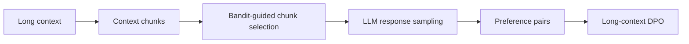

# Long-Context Preference Optimization with LongMab

## Detailed Description

LongMab treats chunks of a long input context as multi-armed bandit arms. Reward-guided chunk selection steers response sampling, and the resulting diverse responses are used to construct preference pairs for Direct Preference Optimization.

## Workflow / Architecture

## Sources

- [Official paper](https://aclanthology.org/2026.acl-long.161/)
- [Author code](https://github.com/NEUIR/LongMab-PO)

[Back to README](../README.md)
